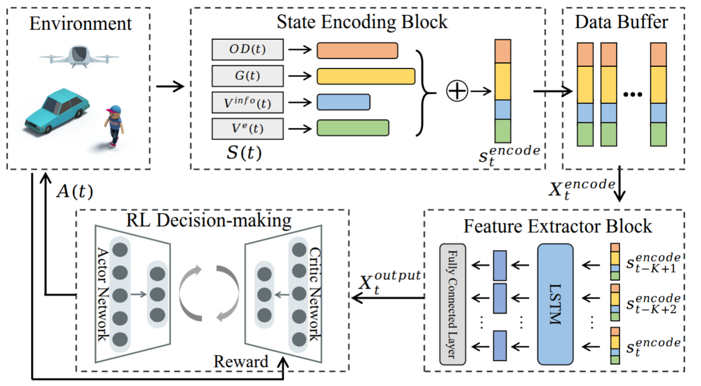

# UAGMC: Urban Air-Ground Mobility Coordination

## 2026-11-03研究更新

[本轮诊断分析与方向共识](analysis_reports/uam_semantics_followup_20261102/01_本轮无训练诊断分析与方向共识.md) · [六千万步训练设计：阶段反馈＋STIN消融](analysis_reports/uam_semantics_followup_20261102/02_正式十八小时训练设计_阶段反馈归因.md) · [上传与运行命令](analysis_reports/uam_semantics_followup_20261102/03_上传启动与下载命令.md)。

[独立训练入口](train_uam_stage_credit_18h_ONEFILE.py)：24个新模型，58,490,880计划步，60,000,000训练工作硬上限；18小时会话上限，预计14–16小时。含公开源码STIN开关消融；未宣称完成新训练或证明新交通机制。原始结果包位于本地项目`experiment_archives`，不含在GitHub代码库内；[复核证据索引](analysis_reports/uam_semantics_followup_20261102/README.md)。

Heterogeneous Vertiport Selection Optimization for On-Demand Air Taxi Services: A Deep Reinforcement Learning Approach

## 📌 Overview

UAGMC proposes an intelligent decision-making framework that leverages multimodal observational data and reinforcement learning to optimize vertiport selection in on-demand air-taxi services. The framework addresses complex, dynamic, and heterogeneous mobility environments by jointly considering passenger demands, ground traffic conditions, vertiport states, and aerial vehicle capabilities.

<div align="center">
  
</div>

## 🚀 Key Features

- **Multi-Source State Representation**: Integrates OD demands, ground speed, vertiport status, and eVTOL capabilities.
- **Temporal Feature Extraction**: Employs LSTM to capture temporal dependencies in heterogeneous state sequences.
- **PPO-based Policy Optimization**: Uses Proximal Policy Optimization for robust and stable learning.
- **Incremental Reward Design**: Tackles sparse reward problem with time-step-wise reward shaping for better training efficiency.

## 🧠 Framework Architecture

The framework consists of three major modules:

1. **State Encoding Block**: Encodes heterogeneous observational data into latent features.
2. **Feature Extractor Block**: Extracts temporal dependencies from sequential encoded states.
3. **Policy Network**: Generates actions (vertiport assignments) using PPO.


## 🚀 Usage

### 🏋️‍♂️ Training Strategies

This project provides three training strategies, each using different state representations. Below are the descriptions and usage instructions for each training script:

**Command to run:**
```python
python rl.py
```
