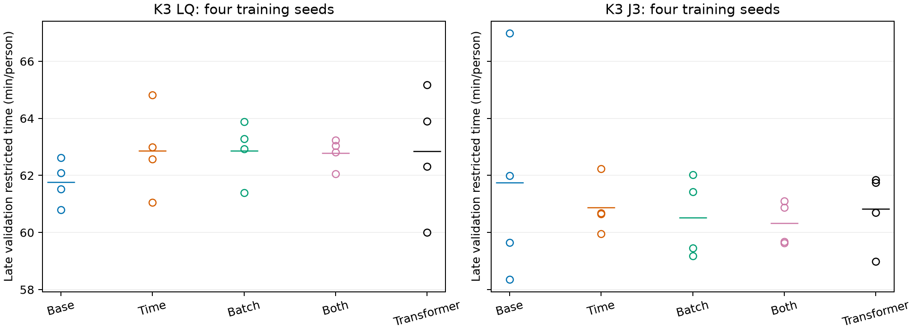
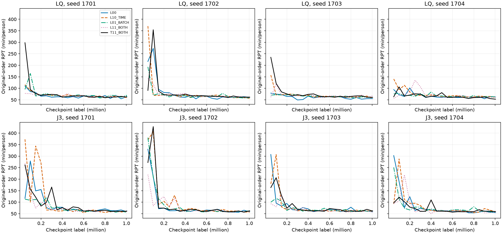

# 五千万训练结果：逐方法看，结论并没有支持“继续补特征就能赢”

2026-11-02｜材料状态：已复算分析（ANALYZED）。依据48格完整DATAONLY包；没有重新训练、回放或读取服务器实时状态。

## 先说重点

**本轮五种做法都学到了相近的服务水平，但没有一种稳定打赢强READY规则。新增时间和凑批特征，也没有形成跨种子一致的性能提升。**

联合的“双信息”平均比零新增信息好1.43分钟/人，看起来不错，但只赢2/4种子；去掉1701这一对后，平均反而差0.06。不能把它讲成稳定的时间对齐收益。

普通Transformer和双信息LSTM接近，不能说“Transformer完全学不会”；也不能因为它没赢就宣布我们需要更高级网络。**下一轮应先校准普通基线的目标范围，而不是再扩充特征或模型池。**

## 一、先确认本轮真实做了什么

| 项目 | 真实合同 |
| --- | --- |
| 完成 | 48/48训练、48/48评估；失败0；48,168,960实际步 |
| 主场景 | E1；3个可选出发站，另有共同目的站；12架飞机；四座满批 |
| 独立重复 | K3每条件4个训练种子1701–1704；K2/K4只有1705一个种子 |
| 控制 | 单侧：乘客学习、飞机最长队规则；联合J3：乘客与飞机均由策略决定 |
| 共同奖励 | PT_POST：每分钟事件处理后，已出现而未完成的人继续扣人时 |
| PPO | 5并行环境×4096步＝20480；batch_size512；10轮更新；学习率5e-4线性到0；gamma=.99；GAE=.95；clip=.25；熵系数.01 |
| 网络 | 六帧LSTM128；或普通一层Transformer；所有组外部描述符槽位等维，关闭填0 |
| 参数量，K3 | LSTM453,639；Transformer438,279；不是精确参数量相等 |
| 训练/评估截止 | 训练名义500分钟；评估名义600，原事件接口实际记录到601次分钟推进；原样保留 |
| 主要比较 | 后20%固定存档×4301–4304四种请求顺序，先模型内平均，再跨训练种子 |

这是新源环境12机队/.99折扣合同，**不是早期40机队、gamma1的V2正式矩阵**。4301–4304只打乱完整OD元组顺序、保持到达时刻和需求多重集；现在都已看过，只能叫验证顺序，不是全新需求分布测试。

新增时间：当前已承诺的供给ready估计、平均充电时间、最近在途乘客、最近返航空机。新增凑批：队列人数及含在途人数除4的余数。它们不是完整世界模型，也不是精确未来排队代价。

**核对通过：** 从逐检查点评估JSON重算四项主表，最大差异约1.4×10^-14；同种子、同控制、同网络的因子臂初始参数hash一致。原始记录未改。

## 二、五种方法全部列出：先看K3主场景

“±”后为四个训练种子的标准差，不是置信区间。所有分数是截止人均累计耗时RPT，越低越好；这些条件都存在未完成场次，因此不能称全体ATT。

| 方法 | 单侧RPT：均值±标准差 | 联合RPT：均值±标准差 | 怎么读 |
| --- | ---: | ---: | --- |
| L00：不新增信息 | 61.760±0.780 | 61.748±3.800 | 两种控制平均几乎一样；联合1701明显较差 |
| L10：只加时间 | 62.860±1.548 | 60.877±0.960 | 单侧均值变差；联合均值变好但仅赢基座2/4 |
| L01：只加四座凑批 | 62.871±1.065 | 60.524±1.416 | 也不是跨种子一致获益；不能宣布凑批特征已经解决问题 |
| L11：两种都加 | 62.788±0.521 | 60.322±0.781 | 联合的离散度较小，但改进方向只2/4一致 |
| T11：两种都加＋普通Transformer | 62.851±2.227 | 60.823±1.330 | 和L11接近；本轮没有证明注意力网络原则上不足 |
| 强READY规则，无需训练 | 56.163 | 56.163 | 实际是同一个“选站规则＋飞机最长队”参照，不是训练过的联合模型 |

40个K3训练模型的后期验证均值都高于56.163。联合L11仍多4.159分钟/人，联合T11多4.659；单侧基座多5.597。它是**具体普通学习基线相对这条强规则的差距**，不是所有UAM算法到全局最优的差距。

强规则对照：同bank的作者SPF=66.663、STTF=65.490、QTTI=67.550。因此模型确实超过这些原始解析参照，但**不能仅选较弱作者规则，忽略已经掌握的READY**。

## 三、每个方法的四个种子，不能只看均值

| 控制/方法 | 1701 | 1702 | 1703 | 1704 |
| --- | ---: | ---: | ---: | ---: |
| 单侧L00 | 61.524 | 62.089 | 62.623 | 60.803 |
| 单侧L10时间 | 62.996 | 61.050 | 64.814 | 62.578 |
| 单侧L01凑批 | 63.881 | 61.387 | 63.291 | 62.926 |
| 单侧L11双信息 | 63.243 | 62.823 | 62.049 | 63.037 |
| 单侧T11普通Transformer | 62.313 | 65.177 | 63.904 | 60.010 |
| 联合L00 | 66.981 | 59.655 | 61.998 | 58.357 |
| 联合L10时间 | 59.955 | 62.228 | 60.651 | 60.675 |
| 联合L01凑批 | 59.182 | 59.457 | 62.027 | 61.428 |
| 联合L11双信息 | 61.103 | 60.884 | 59.675 | 59.627 |
| 联合T11普通Transformer | 61.851 | 60.706 | 61.749 | 58.985 |

逐模型、完整曲线和差值见[evidence](evidence/训练逐模型.csv)。

### 新增信息到底有没有效果？

下表差值＝新做法减基座，负数才改善。区间为训练种子配对差的探索性95% t区间；n=4很小，不能凭区间包含0就宣布“绝对没用”。

| 对照 | 平均差 | 改善种子数 | 95%区间 |
| --- | ---: | ---: | --- |
| 单侧：时间−L00 | +1.100 | 1/4 | [-1.217,3.416] |
| 单侧：凑批−L00 | +1.111 | 1/4 | [-1.151,3.373] |
| 单侧：双信息−L00 | +1.028 | 1/4 | [-0.939,2.995] |
| 联合：时间−L00 | -0.871 | 2/4 | [-7.995,6.254] |
| 联合：凑批−L00 | -1.224 | 2/4 | [-8.591,6.143] |
| 联合：双信息−L00 | -1.426 | 2/4 | [-6.856,4.005] |
| 单侧：Transformer−双信息LSTM | +0.063 | 2/4 | [-3.941,4.067] |
| 联合：Transformer−双信息LSTM | +0.500 | 2/4 | [-1.406,2.406] |

联合L11去掉1701配对后的均值差为+0.059；联合只加时间去掉1701后为+1.181，单独凑批为+0.967。**“新增信息明显有效”的平均印象，很大程度依赖基座的一个差种子。** 不删除它，但必须揭示敏感性。

时间与凑批的交互量L11−L10−L01＋L00：单侧-1.183，联合+0.669，区间分别[-5.243,2.878]、[-8.404,9.743]。没有稳定的“组合额外收益”证据。14个K3探索对比统一作Holm校正，未获得显著发现；完整p值保留在[配对统计](evidence/训练配对统计.csv)，不拿小样本p值替代实际差值。

### 联合到底比单侧怎样？

同一方法下Joint−Single：L00=-0.012；时间=-1.982；凑批=-2.348；双信息=-2.466；Transformer=-2.028。双信息、凑批、Transformer均4/4种子联合更低，双信息的配对t区间为[-3.507,-1.425]。

这是值得保留的**控制方式与信息组织相互影响**的线索，但不是所有统计标准下的确定发现：n=4时，两侧精确符号翻转检验的最小p值也只有0.125；更不能由此宣布“联合必然胜单侧”。控制权和策略头本身不同，比较的是整套实现，不是仅一个动作位的纯因果作用。

## 四、是否大部分都是“垃圾数据”？先看服务状态

后期主评估共960场：83场全员完成，877场未完成。**871场在截止时满足：未完成人全部在站内排队、每站都少于4人、飞机均已IDLE。** 另6场被原代码标为受限执行器阻塞。即未完成场次中约99.3%属于前一可观察类别。

| K3方法 | 单侧：平均乘客完成率／全完成场占比 | 联合：平均乘客完成率／全完成场占比 |
| --- | ---: | ---: |
| L00 | 98.47%／3.75% | 98.47%／7.50% |
| L10时间 | 98.53%／7.50% | 98.30%／3.75% |
| L01凑批 | 98.63%／10.00% | 98.60%／12.50% |
| L11双信息 | 98.65%／13.75% | 98.58%／12.50% |
| T11普通Transformer | 98.42%／3.75% | 98.45%／5.00% |
| 强READY | 99.00%／25.00% | 同一条规则，不重复计样本 |

**98%乘客完成，不是98%的场次全完成。** 四座满批下，每站零星乘客即使有飞机也无法起飞；当前动作集合没有事后改站或不满座救援。因此不能把它们统称为“J的协调死锁”，更不能直接把已完成者平均旅时用于正式排名。

举个算术例子：300人中4人额外等300分钟，就给RPT增加4分钟/人。我们现在讨论的四五分钟差距，可能对少量尾部很敏感。这是量级提醒，不是测得尾批解释了全部差距。

数据可用，但用途必须分开：RPT可用于同截止边界的服务质量诊断；全体ATT仍应缺失；非尾批协调问题要经同等处理或过程分组另证。

## 五、两站和四站的补充，没有支持“双信息普适有效”

只有一个训练种子，不能外推稳定性。

| 出发站数/控制 | L00 | L11双信息 | 双信息变化 |
| --- | ---: | ---: | ---: |
| K2单侧 | 53.820 | 54.704 | +0.884 |
| K2联合 | 53.331 | 53.474 | +0.143 |
| K4单侧 | 66.685 | 70.658 | +3.973 |
| K4联合 | 68.691 | 70.589 | +1.898 |

K4单次退化更明显，下一轮先不扩机场轴。不能事后换更有利的机场数当主场景。

## 六、训练稳定性：不是所有曲线都乱飘

大多数曲线在早期几十万步从很差的服务水平降到60分钟左右，后期没有普遍的大规模崩溃。K3双信息联合的跨种子标准差仅0.781；但“大家都在相近水平”不等于“已经足够好”。

原顺序Best到后期的平均回退：单侧L00约13.54%，其余单侧组约4.99%–6.64%；联合约4.33%–7.76%。这些数会受尾批和Best选择偏差影响，不能直接归因“表示漂移”。

因此当前更准确的说法是：**剩余改进小、尾部影响大、均值对个别种子敏感，导致方法增量结论不牢；不是每次训练都完全失败。**

## 七、时间花在哪里，下一轮18小时怎么算

48格从用户日志12:52:30到22:48:53，共9小时56分23秒。逐格训练用时总9小时16分29秒；评估总28分45秒，余下约11分8秒是规则、父进程、启动与收尾等。

| 类型 | 纯训练加权FPS | 加入评估后的FPS |
| --- | ---: | ---: |
| 单侧LSTM | 1515 | 1438 |
| 联合LSTM | 1401 | 1333 |
| 单侧普通Transformer | 1453 | 1381 |
| 联合普通Transformer | 1315 | 1255 |
| 全轮 | 1443 | 1372；完整实际占机约1346 |

计时插桩显示，网络更新占“采样＋更新”的约10.4%–13.4%；采样约86.6%–89.6%。**采样含策略推理、进程通信和物理仿真，不能叫纯物理占比。** 准备/完成/重置RPC计时约占采样41%–44%，是采样内部的嵌套计时，不能再叠加到采样总和。需要专门剖析才能继续拆出纯仿真CPU时间。

18小时直接乘峰值1477FPS会过于乐观。按完整1346FPS约8723万步；下一轮安排**32格×2,396,160＝76,677,120实际步**，按更保守1200整体FPS约17.75小时。真实共享负载可能让它部分完成，脚本必须如实标注并可续跑。

## 八、本轮推翻什么，保留什么

- 暂不再维护“时间输入补齐就能稳定改善”的预设；这组数据没有支持。
- 不宣布四座余数就是主瓶颈；只加余数也没形成一致收益。
- 不宣布普通Transformer已经被否定；当前差值不足以作这种结论。
- 保留“联合在给定信息组织下可能比单侧更划算”的线索，不强制联合必须胜。
- 保留强READY、完整曲线、四个种子、同等尾批处理、原动作克隆复现这些证据标准。
- WM/MARL、S/AC均暂作后续工具，不再先定方法再找解释。

后续两组实验见第3、4报告。全部数值和口径以[evidence/分析复算.json](evidence/分析复算.json)及原包为准，不覆盖旧报告的历史记录。
