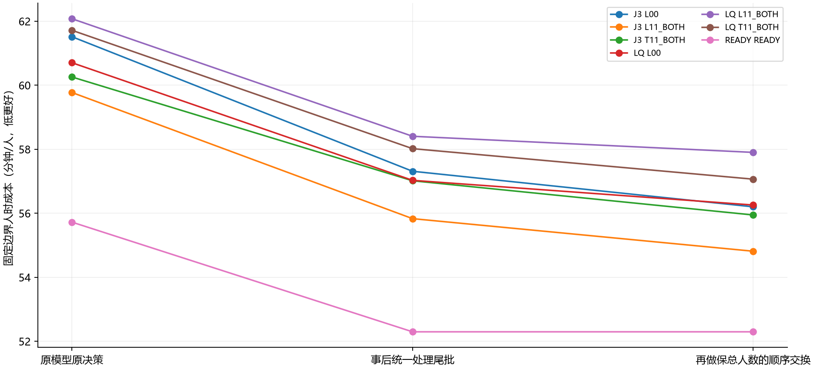

# 报告一：无训练诊断结果——有局部空间，但交通共同缺口尚未完全立住

2026-11-02｜先看本页前两节即可掌握重点；后面是数据和边界。

## Material Passport

- Origin Skill：academic-research-suite / experiment-agent；统计与图形辅助流程。
- Origin Mode：validate；Origin Date：2026-11-02。
- Verification Status：ANALYZED；Version Label：credit_diag_analysis_v1。
- 对象：旧50M中40个K3模型，种子1701–1704，加1个强规则。**不是刚训练完的1801–1804模型。**
- 来源：本地IMPORT_FIXED_DATAONLY归档，原包不修改；未重新仿真。

## 先用白话说结论

1. **普通模型还没做到最好。** 统一事后处理尾批后，再交换两名较早乘客的站点选择、保持每站总人数不变，仍能改善部分整场结果。这说明问题不只是“最后几个人凑不满4座”。
2. **但不能据此说找到了强解析也普遍解决不了的交通问题。** 强READY规则在同样12次随机交换中没有进一步改善，处理尾批后仍比这些普通模型强。
3. **局部看，强READY也会选得不够好。** 18个抽样状态中，穷举候选的240分钟成本，平均还可省89.56人·分钟。这只是局部窗口的可改空间，尚未证明整场也能省这么多。
4. **“gamma太短视”不是主要解释。** .99和1的排序有变化，但换120/240分钟窗口、或删掉未来请求带来的排序变化通常更大；新的训练实验也没有从gamma=1得到普遍收益。
5. 下一步最该补的是：**在最新普通模型和强规则上，把局部更优候选真的接回整场，确认收益是否存在、能否重复，以及主要发生在谁的等待上。**

## 这次到底跑了多大

- 41个控制器：40个训练模型＋1个READY。READY不按种子复制成4个独立模型。
- 3条顺序：original、4301、4302；原OD组合和到达时刻不变，仅重排请求顺序。不是3个新城市，也不是全新需求分布。
- 123条原始回放；2058次整场仿真调用；7068次候选分支调用；450个抽样决策状态；2646条“状态×后续策略×窗口”记录。
- 成功66/66工作单元；权重未更新；450个状态的参考克隆校验均通过。包里还保留66份旧FAILED记录，这是修复前的历史，**不能据此把修复后的成功结果判为失败**。
- 修复后本次实际墙钟1744.26秒，即**29分04秒**；两个CPU工作进程的耗时之和3467.57秒。配置上限一小时，不代表一定用满一小时。COUNTERS里的1459秒是部分内部计时，不能当整套时长。

## 1．先隔离尾批，再看正常阶段还有没有空间

先解释表里的名字：L00＝普通LSTM，不加新描述符；L10_TIME＝只加合法时间描述符；L01_BATCH＝只加“离凑满4座还差多少”的描述符；L11_BOTH＝两者都有；T11_BOTH＝同样信息，历史网络改成普通Transformer。这里BATCH是乘客凑批，不是PPO训练的小批量。READY是不用训练、用合法队列/服务就绪信息估计候选服务代价的在线强规则。

“统一尾批”是事后把最后零星乘客重新分配后，从头重放，并非运行中发现卡住就删除乘客；有真实未来特权，只用于诊断。交换只取前240名乘客，最后60名不动，保持各站人数不变；飞机策略仍会对新状态作反应，因此也不能叫“飞机轨迹固定的纯乘客效应”。

原诊断汇总使用3条顺序；为避免训练原顺序混入，本报告主表另列**只用4301、4302两条验证顺序**的分层敏感性分析，不冒充新增独立确认。先在每个训练模型内平均两次，再平均4个训练种子。original在完整补充表保留。单位是固定601分钟截止下的人时/生成乘客，低更好。脚本名义600分钟，实际推进601个一分钟步；源代码以航空到达为终点，未建模的目的地末段地面时间不补造。

| 控制/模型 | 原回放 | 统一尾批后 | 再交换后 | 交换额外改善 |
| --- | --- | --- | --- | --- |
| 联合J L00 | 63.02 | 58.69 | 57.34 | 1.35 |
| 联合J L01_BATCH | 59.96 | 55.84 | 54.89 | 0.95 |
| 联合J L10_TIME | 62.63 | 57.65 | 54.98 | 2.67 |
| 联合J L11_BOTH | 60.87 | 56.64 | 55.19 | 1.45 |
| 联合J T11_BOTH | 59.77 | 56.59 | 55.33 | 1.26 |
| 单侧S L00 | 60.89 | 57.05 | 56.14 | 0.91 |
| 单侧S L01_BATCH | 61.78 | 58.57 | 57.58 | 0.99 |
| 单侧S L10_TIME | 61.89 | 58.50 | 57.71 | 0.79 |
| 单侧S L11_BOTH | 62.77 | 58.53 | 58.32 | 0.21 |
| 单侧S T11_BOTH | 62.87 | 58.53 | 57.35 | 1.18 |
| 强规则 READY | 54.82 | 51.98 | 51.98 | 0.00 |

例如联合L11从60.87降到56.64，主要是尾批处理；再从56.64降到55.20，才是本次有限顺序交换额外找到的1.45分钟/人。强规则为54.82→51.98→51.98。**不能把前面4.23分钟全算成新时序方法可获得的收益。**

所有统一尾批与交换后样本均全体完成。交换的最好结果允许保持原样，因此改善非负部分来自搜索定义；“4个种子都非负”不能直接当统计显著性。12次未找到改进也不能证明没有改进。

## 2．候选排序告诉我们什么

这里“排序不同”指两套成本的最优动作集合没有交集，平局不强行算错。下表使用3条顺序，模型每臂4种子，每模型18个状态；READY只有18个状态。成本是**人·分钟/一个局部决策**，不是分钟/人，不能与上一表直接相加。

| 控制/模型 | 局部最好可减少人时 | .99与1排序不同 | 60与240分钟排序不同 | 删去后续请求与真回放排序不同 |
| --- | --- | --- | --- | --- |
| 联合J L00 | 201.22 | 4.2% | 31.9% | 29.2% |
| 联合J L11_BOTH | 233.78 | 11.1% | 38.9% | 45.8% |
| 联合J T11_BOTH | 187.72 | 9.7% | 29.2% | 38.9% |
| 单侧S L00 | 218.33 | 15.3% | 19.4% | 38.9% |
| 单侧S L11_BOTH | 187.11 | 23.6% | 37.5% | 44.4% |
| 单侧S T11_BOTH | 189.00 | 8.3% | 40.3% | 37.5% |
| 强规则 READY | 89.56 | 16.7% | 16.7% | 11.1% |

最值得保留的现象：同一状态下，短窗口认为好的动作，长窗口可能不再好。但窗口变化、删请求、不同后续策略是不同干预，不能把它们排成可相加的“因果占比”。

### 不要把“只模拟已承诺”直接当作合法预测器

COMMITTED的实现是删掉尚未出现的请求，而不是从合法需求模型预测后续。满4座的环境里，删掉请求可能人为阻断后续凑批。因此它与真实回放排序不同，既可能因为未来需求重要，也可能因为这个近似世界的尾批结构不对。

联合L11在240分钟、沿原策略继续时，按COMMITTED选动作，在真实回放下平均反而**增加32.61人·分钟**；普通Transformer对应增加16.11。不能直接把这种标签喂给新模型。真实未来版本只作Oracle（事后知道未来的诊断参照），不能进入在线策略输入。

## 3．这是不是“联合协作”问题

在联合L11的240分钟窗口，允许改乘客侧时平均可省218.89人·分钟，只改飞机侧31.11，同时改两侧相对最好单侧的额外收益8.33。联合Transformer分别为160.61、37.89、8.67。

这些数**不是可相加归因百分比**，也不排除飞机状态限制了乘客选择。但当前证据不支持“主要损失必然来自多智能体信用分配”。若现在直接换复杂MARL（多智能体强化学习），仍有再次抽模型的风险。

“人·分钟”表示人数乘等待时间，例如10人各少等1分钟就是10人·分钟；不能读成“每人少等10分钟”。

## 4．关于时序，目前哪些说法不能写成结论

- 后续未出现乘客常贡献较大的局部成本差，但他们的人数和暴露时间也更多。未经人数/等待暴露量归一化，不能说“未来需求解释了90%的问题”。
- PRE/POST是每分钟更新前/更新后计人数。240分钟的无折扣最优集合，本轮主表中几乎不因这一步变化而改变。它不是当前最大的排序来源。
- `after_train_cutoff500`只能说明局部窗口有一部分延伸到500分钟以后。它没有直接提供“去掉截断会带来多少整场改善”的因果答案。
- 本轮没有直接检验“STIN把不同候选的ETA压平，进而造成ATT损失”。这是另一个需要观测和同状态干预验证的假说，不因时序看起来重要就自动成立。

## 5．下一步保留与暂缓

保留：正常阶段可重复损失、决策顺序与承诺窗口、强规则也存在的局部空间，以及单侧/联合同权限对照。

暂缓：gamma=1作为主要修复；COMMITTED标签直接监督；“PPO/Transformer原理上学不会”的叙事；为找好结果改座位、充电或机场数；直接上WM（世界模型）或MARL。它们是后续工具，不是现在已确定的答案。

## 附录：包括original的完整敏感性表

| 控制/模型 | 原回放 | 统一尾批 | 再交换 | 四种子交换增益 |
| --- | --- | --- | --- | --- |
| 联合J L00 | 61.52 | 57.31 | 56.20 | 1.72 / 0.52 / 0.00 / 2.20 |
| 联合J L01_BATCH | 59.84 | 56.04 | 54.99 | 0.52 / 0.96 / 1.94 / 0.78 |
| 联合J L10_TIME | 61.30 | 57.15 | 55.22 | 0.82 / 1.80 / 0.93 / 4.18 |
| 联合J L11_BOTH | 59.77 | 55.83 | 54.81 | 1.44 / 0.35 / 0.75 / 1.53 |
| 联合J T11_BOTH | 60.26 | 57.02 | 55.95 | 0.35 / 0.98 / 2.29 / 0.65 |
| 单侧S L00 | 60.70 | 57.03 | 56.26 | 0.41 / 0.52 / 1.64 / 0.52 |
| 单侧S L01_BATCH | 61.76 | 58.53 | 57.48 | 1.59 / 1.31 / 0.56 / 0.76 |
| 单侧S L10_TIME | 60.70 | 57.62 | 56.93 | 0.49 / 0.40 / 1.60 / 0.24 |
| 单侧S L11_BOTH | 62.08 | 58.41 | 57.90 | 0.44 / 0.35 / 1.00 / 0.23 |
| 单侧S T11_BOTH | 61.72 | 58.02 | 57.07 | 0.59 / 1.28 / 1.61 / 0.33 |
| 强规则 READY | 55.72 | 52.30 | 52.30 | 0.00 |

该图使用3条顺序；主表只用4301/4302，二者口径已分开。强规则不是数学最优。参考记录见`diagnosis_episodes.json`和`diagnosis_branch_windows.json`，本报告不由局部窗口收益推算整场ATT。

## 解释风险检查

11/11类已检查，详见下表。整体证据边界为CAUTION：有限候选、有限状态、已有验证顺序，缺少最新模型上的全程验证，不支持普适因果或投稿结论。

| 已检查的解释风险 | 本轮处理 |
| --- | --- |
| 总体与分组反转 | 分单侧/联合、网络、gamma列出，不用总平均遮盖反转 |
| 从组均值推个体 | 逐训练种子、逐回放保留；不把整体均值说成每名乘客都改善 |
| 筛选人群偏差 | 模型按登记清单全取，不只取低分/坏种子 |
| 碰撞变量偏差 | 不只选全完成场；完成率和成本并列保留 |
| 忽略基率 | 给出总回放数、全完成数、尾批和其他未完成数量 |
| 均值回归 | 不以选中最坏模型后的回升证明修复 |
| 幸存者偏差 | 未完成ATT保持空值，不用已完成人均ATT冒充全体 |
| 多重寻找效应 | 12项配对差全部报告并作保守Holm校正 |
| 分析路径自由度 | 新增探索明确标注；原预注册口径与敏感性口径分开 |
| 相关当因果 | 局部候选收益、跨模型差异、整场干预三类证据分开 |
| 反向因果 | 事件时间顺序记录不足时不将相关性认作时序致因 |

### 分析流程说明

本报告按统计分析、实验设计与学术研究验证流程区分证据、推测和建议，按训练种子聚合，未将多次回放当独立训练样本。图中显示真实种子和完整曲线，不以最低检查点选择赢家。使用现有Python 3.11环境与NumPy/SciPy，不安装技能示例要求的另一套Python 3.12环境；算法和实际软件版本另存清单。未加载模型、未运行新回放、未连接服务器，新增训练0步。

流程工具参考：Timothy Kassis, Vinayak Agarwal, Yuhuan He, Darshil Patel, Aubrey M. Brueckner (2026). [Scientific Agent Skills: A Library of Procedural Knowledge for Research Agents](https://arxiv.org/abs/2609.00065)。该文仅用于说明分析流程，不是UAM机制或方法有效性的证据。
