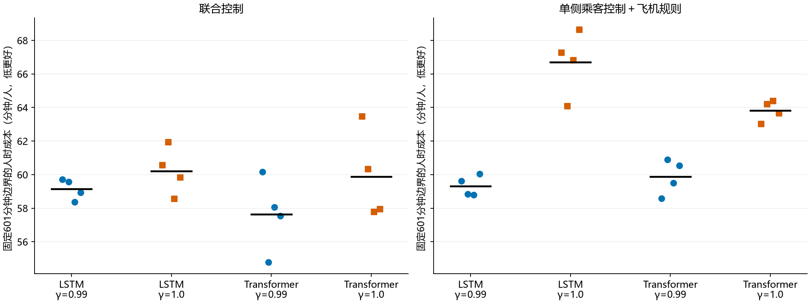
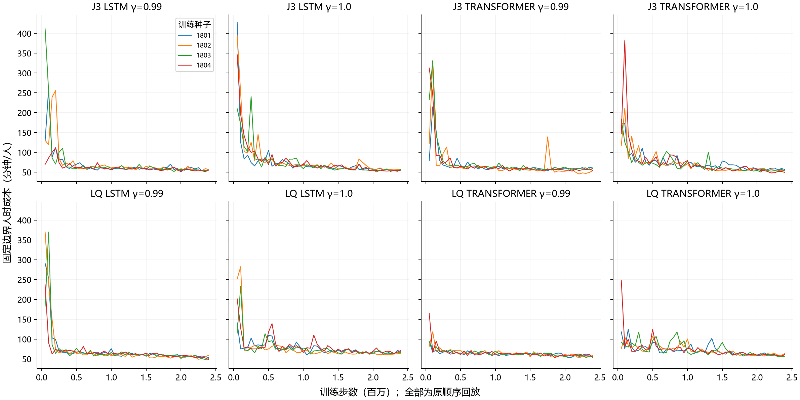

# 报告二：18小时训练结果——gamma=1没有修复问题，普通模型的能力还不能被否定

2026-11-02｜32个模型全部完成；实际76,677,120步。

## Material Passport

- Origin Skill：academic-research-suite / experiment-agent；Origin Mode：validate。
- Origin Date：2026-11-02；Verification Status：ANALYZED；Version Label：credit_train_analysis_v1。
- 来源：32run DATAONLY，强规则取同物理、同验证银行的旧50M RULES_END记录；银行SHA一致。
- 主指标逐条从40次后期回放重新汇总，与32份RESULT逐模型一致；未重新训练或执行策略。

## 先用白话说重点

1. **“把未来看得更远就能解决”这条简单解释没有成立。** γ=1在四个分组的平均成本都更高；单侧LSTM四个种子全部变差，平均增加7.37分钟/人。
2. **普通PPO＋Transformer不能被当成已经排除的弱基线。** 联合Transformer、γ=.99平均57.64，是本轮最好组；其中一个种子54.79，已经低于强READY的56.16，但其他种子没稳定复现。
3. **联合不是必然更好或必然更坏。** γ=.99时，联合LSTM与单侧LSTM几乎相当；联合Transformer平均更好，但只有3/4种子同方向。
4. **模型并非一直乱飘。** 大部分完整曲线从很差的初期降到较集中的平台。更准确的问题是“增量收益依赖种子和配置”，而不是全部数据都没有规律。
5. **现在最需要检查的是这些最新模型具体错在哪。** 当前诊断分析的是旧170x模型，不能用它直接宣布最新180x模型也有相同的正常阶段缺陷。

## 缩写一次解释清楚

- S/单侧：学习乘客选哪个出发站，飞机按既定规则调度；这里不是旧文献中的时间模块S。
- J/Joint：乘客站点和飞机返回方向都进入联合控制；J3是项目控制结构名称，不等于完整MAPPO/HAPPO算法。
- LSTM：顺序读取历史的普通网络。Transformer：普通一层注意力历史网络；本轮不是特殊新结构。
- γ/gamma：对较远成本的折扣。0.99会逐渐降低远期权重，1不降低。本轮逐分钟奖励没变，**优化目标的时间权重确实变了**，所以事先登记为实验因素。
- RPT：截至固定时间，所有已生成但未完成人数的积分÷生成总人数，本文称“固定边界人时成本”。完成后等于相应全体旅时；没完成时不能称完整ATT。
- ATT：全体生成乘客的平均旅时。未全完成的回放保持空值，不用已完成者均值代替。

本轮脚本名义评估600分钟，实际为601个一分钟步。源代码终点是航空到达，未建模的目的地末段地面时间不补造，不冒称覆盖现实完整door-to-door全过程。

## 1．全部八组结果

每组4个独立训练种子1801–1804；每模型训练2,396,160步。主结果先在最后20%的10个固定存档×4条验证顺序内平均，再跨4个训练种子平均。SD表示这4个种子之间的差异，不是40次回放的标准误。

| 控制 | 普通网络 | γ | 后期成本均值±种子SD | 与强READY差 | 全完成场比例 | 最终存档成本 |
| --- | --- | --- | --- | --- | --- | --- |
| 联合J | LSTM | 0.99 | 59.14 ± 0.62 | 2.98 | 8.8% | 58.05 |
| 联合J | LSTM | 1.0 | 60.22 ± 1.40 | 4.05 | 8.1% | 61.19 |
| 联合J | Transformer | 0.99 | 57.64 ± 2.21 | 1.48 | 12.5% | 57.57 |
| 联合J | Transformer | 1.0 | 59.88 ± 2.66 | 3.72 | 16.9% | 58.02 |
| 单侧S | LSTM | 0.99 | 59.32 ± 0.62 | 3.16 | 10.6% | 57.09 |
| 单侧S | LSTM | 1.0 | 66.70 ± 1.92 | 10.53 | 11.9% | 65.84 |
| 单侧S | Transformer | 0.99 | 59.88 ± 1.04 | 3.71 | 11.2% | 57.06 |
| 单侧S | Transformer | 1.0 | 63.82 ± 0.61 | 7.66 | 7.5% | 63.39 |

强规则READY为**56.1633**。源规则SPF/STTF/QTTI分别66.66/65.49/67.55，本轮有不少模型比它们好；但是不能因此回避更强的READY。READY本身也只有1/4验证回放全完成，所以它也不是完美系统或数学下界。

训练、奖励、信息都沿用新近的K3、12架飞机、4座满批E1；5环境×4096步、batch512、10 epochs。**不是10月8日旧40架机队/gamma1冻结协议**。所有组都有相同合法时间和凑批描述符，没有用真实未来，没有辅助损失。不同网络参数数目并非严格相等，详见逐模型清单；同种子同网络的两gamma组初始参数SHA均一致。

## 2．主问题：把γ改为1，究竟怎么样

下表正数表示γ=1更差；四个差值依次对应1801、1802、1803、1804。

| 控制/网络 | γ1−γ.99均值 | 四个配对差 | γ1更好的种子数 | 95% t参考区间 |
| --- | --- | --- | --- | --- |
| J3/LSTM | 1.08 | 0.85 / 2.35 / 0.20 / 0.90 | 0/4 | -0.37 至 2.52 |
| J3/TRANSFORMER | 2.24 | 3.29 / 5.54 / -0.29 / 0.40 | 1/4 | -2.06 至 6.53 |
| LQ/LSTM | 7.37 | 7.64 / 5.23 / 8.03 / 8.59 | 0/4 | 5.02 至 9.73 |
| LQ/TRANSFORMER | 3.94 | 4.43 / 3.32 / 4.87 / 3.14 | 0/4 | 2.60 至 5.28 |

这直接反驳了“只要不折扣，就应该普遍更好”的当前方案。但不证明远期后果不重要，也不证明γ=1永远不好。价值估计、GAE=.95、奖励归一化gamma固定.99、500分钟训练截断和更高回报方差仍可能影响学习；**目前没有数据把这些原因排好主次**。不建议下一步再扫一排gamma碰运气。

统计边界：每个比较只有4个训练种子。精确双侧符号翻转检验的最小p值只有.125，不能凭4/4就写“显著”。原预注册主比较是4项gamma配对，其原始p均不显著；附录再将含次要对比的12项统一做更保守的Holm校正，仍均不显著。t区间只是分布假设下的参考。正态筛查与留一种子敏感性均保存，不按筛查结果临时换检验。跨控制、跨网络不保证初始权重相同，仅gamma内部检查到同初始化。

## 3．普通Transformer和联合控制的含义

在γ=.99下，联合Transformer比联合LSTM平均低1.50分钟/人，3/4种子更好；单侧Transformer反而平均高0.55，只有1/4更好。**普通注意力网络不是处处都赢，也不是毫无用处。**

同为γ=.99，联合LSTM比单侧低0.18，2/4种子更好，几乎没有清楚优势；联合Transformer比单侧低2.23，3/4更好。γ=1时联合相对单侧差距更大，但单侧自己明显退步，不能把这个差距全部解读成“协作能力增强”。

联合Transformer、γ=.99的四个成绩为60.17、54.79、58.06、57.55。它的平均值仍比READY高1.48；一个种子胜出说明“普通方法存在可达性”，不足以证明稳定超越，也不足以宣布必须专门WM/MARL才能解决。

## 4．完整曲线是不是还在乱飘

所有原始曲线保留。多数模型后期仍在改善，不能笼统说都发生后期崩溃；单侧LSTM、γ=1的均值平台较高，反而可能“稳定地差”。Best低于后期平均，也部分受从48个存档中取最低值的选择偏差影响。

| 控制/网络/γ | 原顺序Best→后期回退均值 | 后期斜率（分钟/百万步） |
| --- | --- | --- |
| 联合J LSTM 0.99 | 6.9% | -4.68 |
| 联合J LSTM 1.0 | 4.4% | -4.05 |
| 联合J Transformer 0.99 | 10.2% | -2.24 |
| 联合J Transformer 1.0 | 7.4% | -7.68 |
| 单侧S LSTM 0.99 | 10.8% | -11.49 |
| 单侧S LSTM 1.0 | 6.6% | 0.96 |
| 单侧S Transformer 0.99 | 8.6% | -4.33 |
| 单侧S Transformer 1.0 | 5.8% | -6.17 |

曲线图只用original、eval123，与主表4301–4304不同，**不拼成一条学习曲线**。新2.396M与旧1M使用不同全程学习率衰减和不同训练种子，不能用新中途存档对旧终点，直接归因“多训这些步就带来多少改善”。

## 5．完成率：大部分不是所谓联合永久卡死

1280次后期确认回放中，只有140次全完成，1140次未完成：

- **1111次**：未完成人全部在队列、各站不足4人、所有飞机IDLE，属于当前满座与有限动作集合下的尾批残留。
- **26次**：记录显示受限执行器阻塞，需要逐例查看队列、飞机位置和合法返回机会。
- **3次**：其他未完成状态，不凭总表判断永久卡死。

因此不能将89.1%的未完成场都叫“联合协调失败”。但尾批残留也不能忽略：它真实影响固定截止成本，并让全体ATT无法计算。最终模型128次确认回放仅20次全完成。

新训练包没有全体乘客同口径的ground/wait/flight状态占用积分；不能拿已完成乘客的分项均值替代它们，从而宣称增加的7.37分钟全部来自等待。**这一分解必须用下一轮无训练回放补上。**

## 6．耗时与模型是否保留

整套实际**16小时09分53秒**，在18小时预算内；纯训练合计15小时21分23秒，评估41分15秒，其余为保存/调度等。纯训练加权1387 FPS，整套含评估约1318 FPS。这比计划保守1200 FPS略快，不是任务少跑。

最终模型包已确认32份模型＋32份归一化文件一一配对。这里只验证文件配套，没有重新加载执行。原始三个压缩包、32条曲线、坏种子和所有未完成记录均保留。

## 附录A：32个种子成绩，不只给平均

| 控制/网络/γ | 1801 | 1802 | 1803 | 1804 |
| --- | --- | --- | --- | --- |
| 联合J LSTM 0.99 | 59.71 | 59.57 | 58.36 | 58.93 |
| 联合J LSTM 1.0 | 60.56 | 61.92 | 58.56 | 59.83 |
| 联合J Transformer 0.99 | 60.17 | 54.79 | 58.06 | 57.55 |
| 联合J Transformer 1.0 | 63.47 | 60.34 | 57.77 | 57.95 |
| 单侧S LSTM 0.99 | 59.62 | 58.84 | 58.78 | 60.05 |
| 单侧S LSTM 1.0 | 67.26 | 64.07 | 66.81 | 68.65 |
| 单侧S Transformer 0.99 | 58.59 | 60.89 | 59.51 | 60.53 |
| 单侧S Transformer 1.0 | 63.02 | 64.21 | 64.38 | 63.67 |

## 附录B：全部配对比较

| 对比（前者减后者） | 均值差 | 更低/4种子 | 双侧精确p | Holm p（12项） |
| --- | --- | --- | --- | --- |
| J3/LSTM:gamma1-gamma099 | 1.08 | 0 | 0.125 | 1.000 |
| J3/TRANSFORMER:gamma1-gamma099 | 2.24 | 1 | 0.250 | 1.000 |
| LQ/LSTM:gamma1-gamma099 | 7.37 | 0 | 0.125 | 1.000 |
| LQ/TRANSFORMER:gamma1-gamma099 | 3.94 | 0 | 0.125 | 1.000 |
| J3/gamma0.99:Transformer-LSTM | -1.50 | 3 | 0.375 | 1.000 |
| J3/gamma1.0:Transformer-LSTM | -0.34 | 3 | 0.875 | 1.000 |
| LQ/gamma0.99:Transformer-LSTM | 0.55 | 1 | 0.500 | 1.000 |
| LQ/gamma1.0:Transformer-LSTM | -2.88 | 3 | 0.250 | 1.000 |
| LSTM/gamma0.99:Joint-Single | -0.18 | 2 | 0.750 | 1.000 |
| LSTM/gamma1.0:Joint-Single | -6.48 | 4 | 0.125 | 1.000 |
| TRANSFORMER/gamma0.99:Joint-Single | -2.23 | 3 | 0.375 | 1.000 |
| TRANSFORMER/gamma1.0:Joint-Single | -3.94 | 3 | 0.250 | 1.000 |

## 解释风险检查

11/11类已检查。数据完整性通过、统计主指标重新汇总一致；“训练能否重复”“理论不可学”“交通文献共同缺口”均未被本次运行完整性检查证明。

| 已检查的解释风险 | 本轮处理 |
| --- | --- |
| 总体与分组反转 | 分单侧/联合、网络、gamma列出，不用总平均遮盖反转 |
| 从组均值推个体 | 逐训练种子、逐回放保留；不把整体均值说成每名乘客都改善 |
| 筛选人群偏差 | 模型按登记清单全取，不只取低分/坏种子 |
| 碰撞变量偏差 | 不只选全完成场；完成率和成本并列保留 |
| 忽略基率 | 给出总回放数、全完成数、尾批和其他未完成数量 |
| 均值回归 | 不以选中最坏模型后的回升证明修复 |
| 幸存者偏差 | 未完成ATT保持空值，不用已完成人均ATT冒充全体 |
| 多重寻找效应 | 12项配对差全部报告并作保守Holm校正 |
| 分析路径自由度 | 新增探索明确标注；原预注册口径与敏感性口径分开 |
| 相关当因果 | 局部候选收益、跨模型差异、整场干预三类证据分开 |
| 反向因果 | 事件时间顺序记录不足时不将相关性认作时序致因 |

### 分析流程说明

本报告按统计分析、实验设计与学术研究验证流程区分证据、推测和建议，按训练种子聚合，未将多次回放当独立训练样本。图中显示真实种子和完整曲线，不以最低检查点选择赢家。使用现有Python 3.11环境与NumPy/SciPy，不安装技能示例要求的另一套Python 3.12环境；算法和实际软件版本另存清单。未加载模型、未运行新回放、未连接服务器，新增训练0步。

流程工具参考：Timothy Kassis, Vinayak Agarwal, Yuhuan He, Darshil Patel, Aubrey M. Brueckner (2026). [Scientific Agent Skills: A Library of Procedural Knowledge for Research Agents](https://arxiv.org/abs/2609.00065)。该文仅用于说明分析流程，不是UAM机制或方法有效性的证据。
